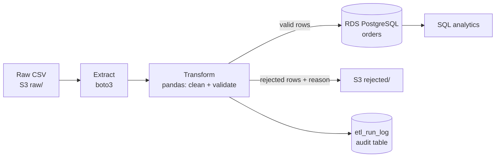

# S3 → RDS ETL Pipeline (AWS, Python, SQL, Terraform)

A small, end-to-end data engineering project. It extracts messy supply-chain purchase-order data from
**Amazon S3**, validates and cleans it with **Python (pandas)**, loads it into **Amazon RDS (PostgreSQL)**
with an idempotent upsert, and analyses it with **SQL** (aggregations, CTEs and window functions).
The cloud infrastructure is created with **Terraform**.



## What the pipeline does

| Step | Detail |
|------|--------|
| Extract | Reads a CSV from S3 (`s3://…`) or from disk. All columns are read as text so nothing is silently coerced. |
| Transform | Trims and standardises text, converts prices (`$1,200.50` → `1200.50`), parses dates, derives `total_cost` and `delivery_days`. |
| Validate | 11 rules (missing supplier, invalid quantity/price/date, unknown status, delivery before order, duplicate `order_id`, …). Failing rows go to `rejected/` in S3 with a `reject_reason` column. |
| Load | `INSERT … ON CONFLICT (order_id) DO UPDATE`, so re-running the pipeline never creates duplicates. |
| Audit | Every run is recorded in the `etl_run_log` table (rows extracted, loaded, rejected, duration). |
| Analyse | `sql/analytics.sql`: top suppliers, monthly spend with running total, delivery performance by region, top 3 suppliers per region (window functions), order status mix. |

The input data is **synthetic** (generated by `etl/generate_data.py`, seeded for reproducibility) with
deliberate problems injected: blanks, bad dates, negative quantities, duplicates and inconsistent casing.

## Project layout

```
etl/            generate_data.py · storage.py · transform.py · load.py · pipeline.py · query.py
sql/            schema.sql · analytics.sql
terraform/      S3 bucket, security group, RDS PostgreSQL
tests/          17 unit and end-to-end tests
.github/        CI: runs tests and `terraform validate`
```

## Run it locally first (free, no AWS needed)

```bash
python -m venv .venv && source .venv/bin/activate      # Windows: .venv\Scripts\activate
pip install -r requirements.txt

python -m etl.generate_data --rows 5000 --out data/raw/orders.csv
python -m etl.pipeline --source data/raw/orders.csv --sqlite demo.db
python -m etl.query --sqlite demo.db
python -m unittest discover -s tests -t . -v
```

## Run it on AWS

You need an AWS account, the AWS CLI configured (`aws configure`) and Terraform ≥ 1.5.

```bash
# 1. Create the infrastructure (about 5–10 minutes for the database)
cd terraform
export TF_VAR_my_ip_cidr="$(curl -s https://checkip.amazonaws.com)/32"
export TF_VAR_db_password='choose-a-strong-password'
terraform init
terraform apply
cd ..

# 2. Upload the raw data
BUCKET=$(terraform -chdir=terraform output -raw bucket_name)
aws s3 cp data/raw/orders.csv s3://$BUCKET/raw/orders.csv

# 3. Point the pipeline at the database
export DB_HOST=$(terraform -chdir=terraform output -raw db_host)
export DB_USER=etl_admin
export DB_PASSWORD="$TF_VAR_db_password"
export DB_NAME=ordersdb

# 4. Run the pipeline and the SQL analysis
python -m etl.pipeline --source s3://$BUCKET/raw/orders.csv --rejects-dest s3://$BUCKET/rejected/
python -m etl.query

# 5. IMPORTANT: delete everything to avoid AWS charges
cd terraform && terraform destroy
```

> **Cost note:** an RDS `db.t3.micro` is free-tier eligible for new AWS accounts for a limited time,
> otherwise it costs a small hourly amount. Run `terraform destroy` as soon as you have captured your results.
> The database is publicly reachable **only from your IP** (a deliberate demo shortcut; a production
> setup would use private subnets and a bastion, VPN or Lambda inside the VPC).

## Results

*Fill this table from your own run (`pipeline` prints a JSON summary).*

| Metric | Value |
|--------|-------|
| Rows read from S3 | |
| Rows loaded into RDS | |
| Rows rejected | |
| Top reject reasons | |
| Pipeline run time (seconds) | |
| Tests passing | 17 / 17 |

## Design decisions

- **Idempotent loads:** upsert on `order_id` makes the pipeline safe to re-run.
- **Nothing is silently dropped:** rejected rows are kept with the reasons, so data owners can fix the source.
- **Same SQL on SQLite and PostgreSQL:** the local demo and the unit tests exercise the real schema and queries.
- **Lazy AWS imports:** the tests need no AWS credentials.
- **Secrets stay out of Git:** the password comes from an environment variable; `.gitignore` excludes state files and `.env`.

## Possible next steps

- Trigger the pipeline automatically with an S3 event → AWS Lambda.
- Move heavy transforms to AWS Glue / Spark when volumes grow.
- Query the rejected files in Amazon Athena.
- Store credentials in AWS Secrets Manager.
